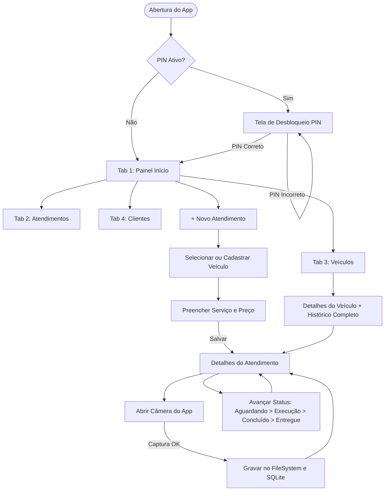
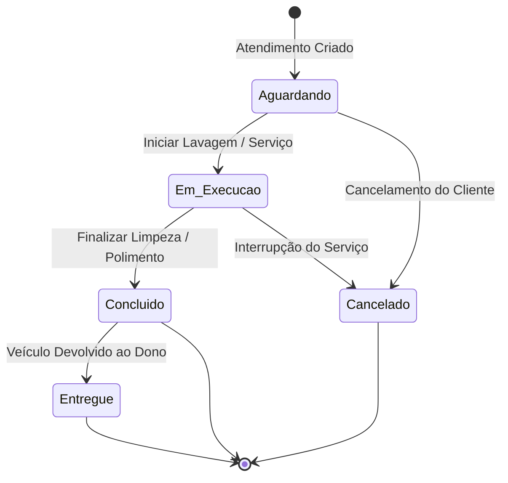
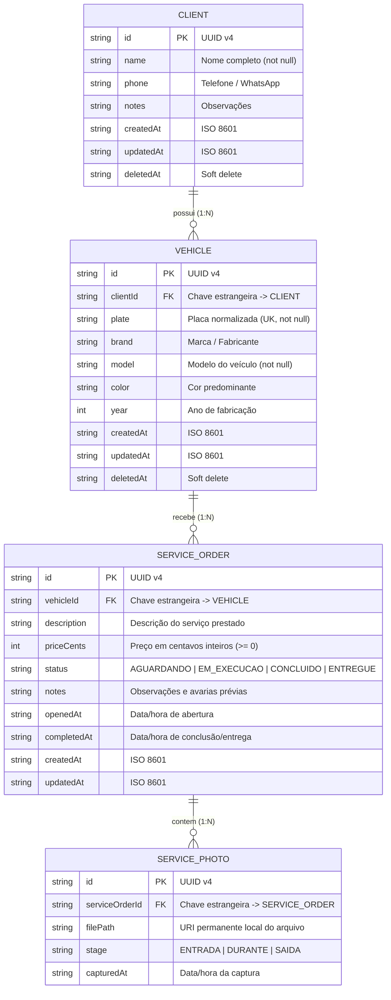
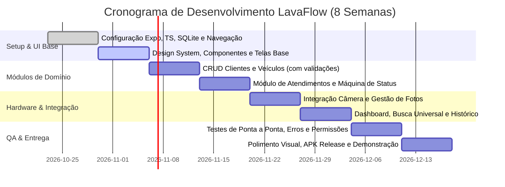

# Especificação de Requisitos e Arquitetura de Software — LavaFlow

**Versão:** 2.0 (Especificação Aprimorada)  
**Status:** Aprovado para Desenvolvimento  
**Data:** 22 de Outubro de 2026  
**Plataforma Alvo:** Android (React Native + Expo + TypeScript)  
**Tipo de Documento:** SRS (Software Requirements Specification) & Arquitetura Técnica  

---

## Sumário
1. [Visão Geral do Produto](#1-visão-geral-do-produto)
   - 1.1 Identificação e Propósito
   - 1.2 Declaração do Problema
   - 1.3 Público-Alvo e Personas
   - 1.4 Objetivos do MVP
2. [Escopo e Priorização (MoSCoW)](#2-escopo-e-priorização-moscow)
   - 2.1 Must Have (Essencial / MVP)
   - 2.2 Should Have (Melhorias com Folga no Prazo)
   - 2.3 Won't Have (Fora do Escopo desta Versão)
3. [Requisitos Funcionais Detalhados](#3-requisitos-funcionais-detalhados)
   - RF01: Controle de Acesso do Proprietário (PIN Local)
   - RF02: Gestão de Clientes
   - RF03: Gestão de Veículos e Placas
   - RF04: Registro e Abertura de Atendimentos
   - RF05: Gestão do Ciclo de Vida e Status do Atendimento
   - RF06: Captura e Gestão de Fotos com Câmera Nativa
   - RF07: Painel Operacional (Dashboard)
   - RF08: Pesquisa Universal e Histórico por Veículo
4. [Regras de Negócio (RN)](#4-regras-de-negócio-rn)
5. [Arquitetura de Navegação e Telas](#5-arquitetura-de-navegação-e-telas)
   - 5.1 Estrutura de Rotas e Telas
   - 5.2 Diagrama de Fluxo de Navegação
   - 5.3 Máquina de Estados do Atendimento
6. [Integração de Hardware e APIs Nativas](#6-integração-de-hardware-e-apis-nativas)
   - 6.1 Câmera Nativa (`expo-camera`)
   - 6.2 Sistema de Arquivos e Armazenamento de Imagens (`expo-file-system`)
   - 6.3 Gestão de Permissões Android
7. [Arquitetura Técnica e Modelo de Dados](#7-arquitetura-técnica-e-modelo-de-dados)
   - 7.1 Stack Tecnológica
   - 7.2 Estrutura de Diretórios Recomendada
   - 7.3 Diagrama Entidade-Relacionamento (ERD)
   - 7.4 Dicionário e DDL do Banco de Dados Local (SQLite)
8. [Requisitos Não Funcionais (RNF)](#8-requisitos-não-funcionais-rnf)
9. [Matriz de Riscos e Mitigações](#9-matriz-de-riscos-e-mitigações)
10. [Plano de Desenvolvimento e Marcos (8 Semanas)](#10-plano-de-desenvolvimento-e-marcos-8-semanas)
11. [Critérios de Aceitação da Versão Final (Checklist)](#11-critérios-de-aceitação-da-versão-final-checklist)
12. [Roteiro de Demonstração e Homologação](#12-roteiro-de-demonstração-e-homologação)

---

## 1. Visão Geral do Produto

### 1.1 Identificação e Propósito
O **LavaFlow** é um aplicativo móvel voltado para a gestão operacional de lava-jatos, oficinas de estética automotiva e profissionais autônomos de detalhamento (*auto detailing*). O aplicativo centraliza o registro de clientes, veículos atendidos, serviços prestados, valores cobrados, acompanhamento de status em tempo real e o registro fotográfico dos veículos antes, durante e após o serviço.

### 1.2 Declaração do Problema
| Situação Atual (Sem o App) | Consequência | Solução LavaFlow |
| :--- | :--- | :--- |
| Anotações em cadernos de papel ou blocos avulsos. | Perda de histórico, rasuras, folhas molhadas pela operação da lavação. | Dados salvos localmente e protegidos no smartphone do proprietário. |
| Negociações e pedidos dispersos no WhatsApp. | Dificuldade em saber o que já foi finalizado e o que está na fila. | Painel central com contagem de status (*Aguardando*, *Em Execução*, *Concluído*, *Entregue*). |
| Falta de registro visual da condição do carro no recebimento. | Disputas com clientes sobre riscos ou amassados pré-existentes. | Captura direta de fotos vinculadas ao atendimento com timestamp. |
| Consulta demorada sobre serviços e preços anteriores de um cliente. | Perda de tempo e inconsistência na precificação de clientes recorrentes. | Histórico instantâneo com busca por placa e nome do cliente. |

### 1.3 Público-Alvo e Personas
- **Proprietários de Lava-Jatos de Pequeno e Médio Porte:** Necessitam de rapidez na recepção do veículo para não formar fila no pátio.
- **Centros de Estética Automotiva / Detailers:** Precisam de registro fotográfico detalhado (estado da pintura, bancos, rodas) para comprovar a evolução do serviço.
- **Lavadores Autônomos e Delivery:** Operam sozinhos no pátio, precisando de uma interface com botões grandes, intuitiva e que funcione 100% offline.

### 1.4 Objetivos do MVP
Entregar uma aplicação Android robusta, de operação individual (mono-usuário no próprio aparelho do dono), independente de servidores externos para o fluxo principal (armazenamento local SQLite), com tempo de cadastro de um novo atendimento inferior a 45 segundos e integração fluida com a câmera nativa do Android.

---

## 2. Escopo e Priorização (MoSCoW)

### 2.1 Must Have (Essencial / MVP Obrigatório)
- [x] CRUD completo de Clientes (com validações de campos obrigatórios).
- [x] CRUD completo de Veículos associados aos clientes (normalização de placas padrão Mercosul e Antigo).
- [x] Registro de Atendimento com seleção de veículo, descrição textual do serviço e valor em Reais (BRL).
- [x] Transição de status do atendimento (*Aguardando* → *Em Execução* → *Concluído* → *Entregue*).
- [x] Captura de fotos via câmera nativa com persistência permanente no armazenamento do aplicativo.
- [x] Painel de controle inicial (Dashboard) com contadores em tempo real por status e lista de atendimentos do dia.
- [x] Busca rápida de veículos por placa e clientes por nome (case-insensitive).
- [x] Persistência relacional em banco de dados local SQLite com proteção contra deleção acidental de histórico.
- [x] Interface 100% em português brasileiro, adaptada para ergonomia mobile (Material Design 3).

### 2.2 Should Have (Melhorias com Folga no Prazo)
- Seleção de fotos da Galeria do dispositivo (fallback para fotos já tiradas).
- Compartilhamento de resumo do atendimento via `Share API` do sistema (texto formatado para envio no WhatsApp do cliente).
- Campo de observações com marcação de avarias pré-existentes.
- Filtro do painel por período (Hoje / Semana / Mês).
- Feedback tátil (vibração háptica) nas transições de status e confirmação de fotos.

### 2.3 Won't Have (Fora do Escopo da Versão 1.0)
- Multi-tenancy ou login de múltiplos funcionários com permissões de acesso diferenciadas.
- Portal web ou aplicativo externo para consulta direta pelo cliente final.
- Agendamento de horários futuros com calendário integrado.
- Integração direta via API oficial do WhatsApp Business.
- Módulo fiscal (emissão de NFS-e / NFC-e) e gestão de contas a pagar/receber.
- Módulo de estoque de produtos químicos e consumíveis.
- Sincronização em nuvem multi-dispositivo em tempo real.
- Publicação mandatória na Google Play Store (o pacote será gerado via APK de release / Expo Development Build).

---

## 3. Requisitos Funcionais Detalhados

### RF01 — Controle de Acesso do Proprietário (PIN Local Opcional)
- **Descrição:** Mecanismo simplificado para resguardar a privacidade dos dados caso o aparelho seja manuseado por terceiros no pátio.
- **Entrada:** PIN numérico de 4 a 6 dígitos cadastrado na primeira execução.
- **Processamento:** Comparação do hash do PIN armazenado de forma segura no `expo-secure-store`.
- **Critérios de Aceitação (BDD):**
  - *Dado* que o PIN está configurado, *quando* o app for aberto, *então* deve exibir o teclado numérico de desbloqueio.
  - *Dado* que o usuário digitou o PIN incorreto, *quando* confirmar, *então* deve exibir "PIN incorreto" e manter a aplicação bloqueada.
  - *Dado* que a opção de PIN não foi habilitada nas configurações, *quando* o app for aberto, *então* a tela inicial (Dashboard) deve ser carregada diretamente.

### RF02 — Gestão de Clientes
- **Descrição:** Manutenção do cadastro dos clientes atendidos pelo estabelecimento.
- **Campos:** `id` (UUID), `nome` (Obrigatório, min. 3 caracteres), `telefone` (Opcional, com máscara `(XX) XXXXX-XXXX`), `observacoes` (Opcional), `createdAt`, `updatedAt`, `deletedAt` (Soft Delete).
- **Regras:**
  - Não permitir gravação de cliente com nome vazio ou composto apenas por espaços.
  - Busca em tempo real por qualquer trecho do nome (ex: "Carlos" localiza "Carlos Eduardo" e "João Carlos").
  - Caso o cliente possua veículos ou atendimentos vinculados, sua exclusão deve ser bloqueada ou realizada por arquivamento lógico (Soft Delete), impedindo a quebra de integridade referencial.
- **Critérios de Aceitação (BDD):**
  - *Dado* que o usuário está na tela de Novo Cliente, *quando* preencher o nome e salvar, *então* o cliente deve constar na listagem imediatamente.
  - *Dado* um cliente com 2 veículos cadastrados, *quando* o usuário solicitar exclusão, *então* o sistema deve alertar: "Este cliente possui veículos associados e não pode ser excluído permanentemente".

### RF03 — Gestão de Veículos e Placas
- **Descrição:** Cadastro dos automóveis associados a um cliente existente.
- **Campos:** `id` (UUID), `clienteId` (FK obrigatória), `placa` (Obrigatória, normalizada), `marca` (Opcional), `modelo` (Obrigatório), `cor` (Opcional), `ano` (Opcional), `createdAt`, `updatedAt`.
- **Normalização de Placa:**
  - Aceita formato Antigo (`ABC-1234` ou `ABC1234`) e Mercosul (`ABC1D23` para carros ou `ABC12D3` para motos).
  - Toda entrada de placa deve ser convertida em caixa alta (`uppercase`), sem hífens ou caracteres especiais (armazenamento puro em 7 caracteres alfanuméricos: regex `^[A-Z]{3}[0-9][A-Z0-9][0-9]{2}$`).
  - Alerta imediato caso a placa já se encontre cadastrada no banco de dados.
- **Critérios de Aceitação (BDD):**
  - *Dado* a digitação da placa `bra-2e19`, *quando* salvar, *então* o banco deve gravar `BRA2E19`.
  - *Dado* a tentativa de cadastro de um veículo sem associar um cliente existente, *quando* clicar em salvar, *então* o campo de seleção de cliente deve acusar obrigatoriedade.

### RF04 — Registro de Atendimentos (Ordens de Serviço)
- **Descrição:** Abertura e manutenção de ordens de serviço vinculadas a um veículo.
- **Campos:** `id` (UUID), `veiculoId` (FK obrigatória), `descricaoServico` (Obrigatório), `precoCentavos` (Obrigatório, valor inteiro positivo em centavos), `status` (Enum), `observacoes` (Opcional), `dataAbertura` (ISO 8601), `dataConclusao` (ISO 8601, opcional), `createdAt`, `updatedAt`.
- **Tratamento Monetário:**
  - Armazenamento em número inteiro no SQLite (`precoCentavos`), onde `R$ 85,50` é armazenado como `8550`, prevenindo erros de arredondamento de ponto flutuante IEEE 754.
  - Interface com máscara monetária dinâmica em Reais (`R$ 0,00`).
- **Critérios de Aceitação (BDD):**
  - *Dado* a criação de um atendimento, *quando* o usuário preencher o serviço "Lavagem Completa + Cera" e o valor "R$ 120,00", *então* o atendimento deve ser gravado com status inicial `Aguardando`.
  - *Dado* a tentativa de inserir valor negativo ou zerado não justificado, *quando* salvar, *então* deve exibir aviso de validação.

### RF05 — Gestão do Ciclo de Vida e Status do Atendimento
- **Descrição:** Acompanhamento e avanço dos estados de execução de um serviço.
- **Estados Possíveis:**
  1. `AGUARDANDO` — Veículo no pátio aguardando início dos trabalhos.
  2. `EM_EXECUCAO` — Veículo no box de lavagem ou em polimento.
  3. `CONCLUIDO` — Serviço finalizado, pronto e aguardando retirada pelo cliente.
  4. `ENTREGUE` — Veículo devolvido ao proprietário e conta acertada.
  5. `CANCELADO` — Atendimento abortado antes da finalização.
- **Ações:**
  - Botão de avanço rápido de status na tela de detalhes do atendimento.
  - Registro automático do timestamp de conclusão no momento da transição para `CONCLUIDO` ou `ENTREGUE`.
- **Critérios de Aceitação (BDD):**
  - *Dado* um atendimento em status `Aguardando`, *quando* o usuário clicar em "Iniciar Serviço", *então* o status deve mudar para `Em Execução` e atualizar a contagem no Dashboard.
  - *Dado* um atendimento no status `Entregue`, *quando* consultado no histórico, *então* seus dados e fotos devem permanecer intactos para conferência.

### RF06 — Captura e Gestão de Fotos com Câmera Nativa
- **Descrição:** Captura de fotos através do hardware de câmera do dispositivo para comprovar o estado do veículo antes e após a execução do serviço.
- **Campos:** `id` (UUID), `atendimentoId` (FK obrigatória), `caminhoArquivo` (URI local persistente), `etapa` (`ENTRADA` / `DURANTE` / `SAIDA`), `capturadoEm` (ISO 8601).
- **Especificações de Armazenamento:**
  - A foto temporária gerada pelo sensor da câmera deve ser copiada para o diretório de documentos permanente do aplicativo (`FileSystem.documentDirectory + 'photos/{atendimentoId}/'`).
  - O banco SQLite salva apenas a URI relativa ou persistente, evitando que limpezas de cache do Android (`cacheDir`) excluam fotos dos clientes.
  - Compressão controlada (qualidade JPEG entre 0.7 e 0.8) e redimensionamento máximo para 1920x1080 pixels para não esgotar a memória do dispositivo.
- **Critérios de Aceitação (BDD):**
  - *Dado* que o usuário clica em "Tirar Foto" dentro do atendimento, *quando* o app ainda não possui permissão, *então* deve exibir diálogo explicativo do sistema operacional solicitando acesso à câmera.
  - *Dado* que a permissão foi negada, *quando* retornar à tela, *então* o app não deve travar e deve exibir banner informando: "Permissão de câmera necessária para fotos do veículo".
  - *Dado* uma foto capturada com sucesso, *quando* o aplicativo for reiniciado ou o aparelho reiniciado, *então* a foto deve continuar carregando na galeria do atendimento.

### RF07 — Painel Operacional (Dashboard)
- **Descrição:** Tela principal com visão consolidada dos veículos presentes no pátio e produtividade diária.
- **Componentes:**
  - 4 Cards numéricos coloridos por status: `Aguardando` (amarelo/âmbar), `Em Execução` (azul), `Concluído` (verde) e `Entregue Hoje` (cinza/neutro).
  - Botão de Ação Flutuante (FAB) ou atalho superior: "Novo Atendimento", "Novo Cliente", "Novo Veículo".
  - Lista rápida com os atendimentos ativos em ordem decrescente de atualização.
  - *Empty State* amigável quando não houver atendimentos no dia, instruindo a cadastrar o primeiro veículo.
- **Critérios de Aceitação (BDD):**
  - *Dado* que existem 3 veículos aguardando e 2 em execução, *quando* abrir o app, *então* os cards devem exibir "3" e "2" respectivamente.
  - *Dado* que um atendimento foi alterado para "Concluído", *quando* voltar ao Dashboard, *então* o contador de "Concluídos" deve ser incrementado sem necessidade de reiniciar o app.

### RF08 — Pesquisa Universal e Histórico por Veículo
- **Descrição:** Localização imediata de histórico por placa ou nome de cliente.
- **Funcionamento:**
  - Campo de busca com debounce (300ms) para não sobrecarregar a UI.
  - Ao digitar uma placa (ex: "ABC"), lista todos os veículos compatíveis.
  - Ao selecionar um veículo, exibe o cartão com dados do proprietário e a lista cronológica de todos os atendimentos já realizados naquele automóvel (com datas, serviços e valores).
- **Critérios de Aceitação (BDD):**
  - *Dado* a digitação parcial de uma placa "1234", *quando* a busca for executada, *então* devem ser retornados todos os veículos contendo "1234" na placa.
  - *Dado* que um veículo possui 5 atendimentos históricos, *quando* abrir os detalhes do veículo, *então* todos os 5 atendimentos devem ser exibidos do mais recente para o mais antigo.

---

## 4. Regras de Negócio (RN)

| Código | Descrição da Regra | Justificativa |
| :--- | :--- | :--- |
| **RN01** | **Integridade Cliente-Veículo:** Todo veículo deve obrigatoriamente estar associado a um cliente existente. | Impossível realizar cobrança ou contato sem um responsável pelo bem. |
| **RN02** | **Integridade Veículo-Atendimento:** Todo atendimento deve estar associado a exatamente um veículo. | O histórico e as fotos são vinculados diretamente ao patrimônio atendido. |
| **RN03** | **Unicidade de Placa:** Não é permitido o cadastro de dois veículos ativos com a mesma placa no sistema. | A placa é o identificador automotivo nacional único. |
| **RN04** | **Formatação de Moeda:** Preços devem ser números inteiros (centavos), não negativos, representados com duas casas decimais no frontend. | Evita dízimas e inconsistências contábeis de ponto flutuante em SQLite. |
| **RN05** | **Status Inicial Obrigatório:** Todo atendimento novo inicia compulsoriamente no status `AGUARDANDO`. | Garante que o fluxo de entrada e triagem seja padronizado. |
| **RN06** | **Proteção contra Deleção em Cascata Acidental:** É proibido deletar fisicamente do banco um cliente ou veículo que possua atendimentos registrados. O sistema deve utilizar *Soft Delete* (`deletedAt IS NOT NULL`) ou bloquear a operação com mensagem orientadora. | Protege o histórico financeiro e fotográfico contra toques acidentais no celular. |
| **RN07** | **Persistência Imediata de Mídia:** A foto capturada deve ser imediatamente gravada no diretório permanente do app antes de atualizar a lista da tela. | Previne a perda da foto caso o Android finalize a aplicação por pressão de memória. |
| **RN08** | **Imutabilidade de Atendimentos Entregues:** Um atendimento no status `ENTREGUE` não pode ter seu preço ou veículo alterado, permitindo apenas adição de observações complementares. | Garante a integridade dos dados históricos após o encerramento do serviço. |
| **RN09** | **Operação Offline First:** Toda gravação, consulta e captura deve funcionar perfeitamente sem qualquer conexão de dados ou Wi-Fi ativa. | Ambientes de lava-jato frequentemente possuem sinal de internet instável no pátio. |
| **RN10** | **Normalização de Textos:** Nomes de clientes e descrições de serviços devem ter espaços extras removidos (*trim*) e placas devem ser salvas sempre em maiúsculas sem traços. | Evita duplicidades visuais e falhas em consultas SQL (`LIKE` / `=`). |

---

## 5. Arquitetura de Navegação e Telas

### 5.1 Estrutura de Rotas e Telas
O aplicativo adota a navegação padrão recomendada para Android via **Bottom Tabs Navigation** (Menu Inferior) para as áreas principais, combinada com **Native Stack Navigation** para telas de formulários e detalhes.

```
App Navigation
├── Bottom Tabs (Navegação Principal)
│   ├── Tab Início (Dashboard / Painel Geral)
│   ├── Tab Atendimentos (Lista filtrável de OS ativas e concluídas)
│   ├── Tab Veículos (Busca por placa e lista de automóveis)
│   └── Tab Clientes (Lista e pesquisa de clientes)
└── Modais & Telas em Pilha (Stack)
    ├── Tela de Acesso / Desbloqueio PIN (se habilitado)
    ├── Formulário de Cliente (Criar / Editar)
    ├── Formulário de Veículo (Criar / Editar com seleção de cliente)
    ├── Formulário de Novo Atendimento (Fluxo Guiado)
    ├── Detalhes do Atendimento (Linha do tempo, status, galeria de fotos)
    ├── Câmera de Captura (Visualizador com guias de enquadramento)
    ├── Visualizador de Foto em Tela Cheia (Zoom e exclusão)
    └── Detalhes do Veículo (Ficha técnica + Histórico de Atendimentos)
```

### 5.2 Diagrama de Fluxo de Navegação



### 5.3 Máquina de Estados do Atendimento



---

## 6. Integração de Hardware e APIs Nativas

### 6.1 Câmera Nativa (`expo-camera`)
- **Finalidade:** Obtenção de provas visuais do veículo (estado de conservação na entrada, comprovação do serviço pronto na saída).
- **Parâmetros Técnicos de Captura:**
  - Modo: Fotografia (`CameraType.back`).
  - Resolução: Limitada a Full HD (1920x1080) com aspect ratio 4:3 ou 16:9 para economia de memória RAM e disco.
  - Flash: Alternador Manual (Desligado / Ligado / Automático) para atender pátios cobertos com baixa luminosidade.
  - Feedback Visual: Animação de obturador (*shutter effect*) e indicador visual de salvamento.

### 6.2 Sistema de Arquivos e Armazenamento Local (`expo-file-system`)
- **Problema de Pastas Temporárias:** O `expo-camera` grava por padrão em `cacheDirectory`, pasta que o sistema operacional Android limpa automaticamente quando o aparelho está com pouca memória livre.
- **Estratégia de Persistência:**
  1. Ao disparar a foto, obtém-se o arquivo temporário: `${FileSystem.cacheDirectory}Camera/temp_xxx.jpg`.
  2. Garante-se a criação do diretório definitivo: `${FileSystem.documentDirectory}orders/${orderId}/`.
  3. Executa-se `FileSystem.copyAsync()` para o destino permanente: `${FileSystem.documentDirectory}orders/${orderId}/photo_${uuid}.jpg`.
  4. Grava-se no banco de dados SQLite a URI permanente ou caminho relativo (`orders/${orderId}/photo_${uuid}.jpg`).
  5. Remove-se o arquivo temporário do cache.

### 6.3 Gestão de Permissões Android
- **Permissões Declaradas:** `android.permission.CAMERA`.
- **Estratégia UX de Permissão em Tempo de Execução:**
  - *Justificativa Prévia (Rationale):* Antes de invocar a permissão nativa, o app exibe modal explicativo: *"O LavaFlow precisa de acesso à sua câmera para fotografar o estado do veículo no início e fim do atendimento"*.
  - *Tratamento de Negativa:* Se o usuário recusar, o app apresenta um botão com instrução para abrir as configurações do sistema (`Linking.openSettings()`), sem fechar nem travar as outras funções do aplicativo.

---

## 7. Arquitetura Técnica e Modelo de Dados

### 7.1 Stack Tecnológica
- **Linguagem:** TypeScript 5.x (Strict Type Checking ativo).
- **Framework Mobile:** React Native 0.74+ com Expo SDK 51/52 (Managed Workflow).
- **Navegação:** React Navigation v6 / v7 (`@react-navigation/native`, `@react-navigation/bottom-tabs`, `@react-navigation/native-stack`).
- **Banco de Dados Local:** `expo-sqlite` (utilizando a nova API moderna baseada em `SQLiteDatabase`, transações assíncronas e WAL mode habilitado).
- **Manipulação de Arquivos e Mídia:** `expo-camera`, `expo-file-system`, `expo-image-manipulator` (para redimensionamento/compressão leve).
- **Estilização e Componentes:** StyleSheet nativo + Design System customizado seguindo diretrizes do Material Design 3 (cores semânticas, áreas de toque de 48dp mínimo).
- **Ícones:** `@expo/vector-icons` (MaterialCommunityIcons e Ionicons).

### 7.2 Estrutura de Diretórios Recomendada
```
lavaflow/
├── app.json                  # Configurações do Expo e permissões Android
├── package.json
├── tsconfig.json
└── src/
    ├── database/             # Camada de banco de dados SQLite
    │   ├── database.ts       # Inicialização da conexão, PRAGMAs e migrações
    │   ├── schema.ts         # Comandos DDL de criação das tabelas e índices
    │   └── repositories/     # Consultas e operações (Client, Vehicle, Order, Photo)
    ├── navigation/           # Roteamento e stacks
    │   ├── AppNavigator.tsx
    │   ├── TabNavigator.tsx
    │   └── types.ts          # Tipagem estrita de rotas (RootStackParamList)
    ├── screens/              # Telas da aplicação
    │   ├── DashboardScreen.tsx
    │   ├── clients/          # Listagem, Cadastro e Detalhes
    │   ├── vehicles/         # Listagem, Cadastro e Histórico
    │   ├── orders/           # Listagem, Novo Atendimento e Detalhes
    │   └── camera/           # Câmera Customizada e Preview
    ├── components/           # Componentes visuais reutilizáveis
    │   ├── common/           # Button, Input, Card, Badge, Header, EmptyState
    │   └── orders/           # StatusBadge, PriceInput, PhotoGallery, OrderCard
    ├── services/             # Regras de integração (CameraService, StorageService)
    ├── types/                # Interfaces de domínio (Entities, DTOs, Enums)
    └── utils/                # Máscaras de placa, formatação BRL, validações, datas
```

### 7.3 Diagrama Entidade-Relacionamento (ERD)



### 7.4 DDL do Banco de Dados Local (SQLite)

```sql
-- Configuração de performance e integridade
PRAGMA journal_mode = WAL;
PRAGMA foreign_keys = ON;

-- Tabela de Clientes
CREATE TABLE IF NOT EXISTS clients (
    id TEXT PRIMARY KEY NOT NULL,
    name TEXT NOT NULL,
    phone TEXT,
    notes TEXT,
    createdAt TEXT NOT NULL,
    updatedAt TEXT NOT NULL,
    deletedAt TEXT
);

CREATE INDEX IF NOT EXISTS idx_clients_name ON clients(name);
CREATE INDEX IF NOT EXISTS idx_clients_deleted ON clients(deletedAt);

-- Tabela de Veículos
CREATE TABLE IF NOT EXISTS vehicles (
    id TEXT PRIMARY KEY NOT NULL,
    clientId TEXT NOT NULL,
    plate TEXT NOT NULL UNIQUE,
    brand TEXT,
    model TEXT NOT NULL,
    color TEXT,
    year INTEGER,
    createdAt TEXT NOT NULL,
    updatedAt TEXT NOT NULL,
    deletedAt TEXT,
    FOREIGN KEY (clientId) REFERENCES clients(id) ON DELETE RESTRICT
);

CREATE INDEX IF NOT EXISTS idx_vehicles_plate ON vehicles(plate);
CREATE INDEX IF NOT EXISTS idx_vehicles_client ON vehicles(clientId);

-- Tabela de Atendimentos (Ordens de Serviço)
CREATE TABLE IF NOT EXISTS service_orders (
    id TEXT PRIMARY KEY NOT NULL,
    vehicleId TEXT NOT NULL,
    description TEXT NOT NULL,
    priceCents INTEGER NOT NULL CHECK(priceCents >= 0),
    status TEXT NOT NULL DEFAULT 'AGUARDANDO',
    notes TEXT,
    openedAt TEXT NOT NULL,
    completedAt TEXT,
    createdAt TEXT NOT NULL,
    updatedAt TEXT NOT NULL,
    FOREIGN KEY (vehicleId) REFERENCES vehicles(id) ON DELETE RESTRICT
);

CREATE INDEX IF NOT EXISTS idx_orders_status ON service_orders(status);
CREATE INDEX IF NOT EXISTS idx_orders_vehicle ON service_orders(vehicleId);
CREATE INDEX IF NOT EXISTS idx_orders_opened ON service_orders(openedAt DESC);

-- Tabela de Fotos do Atendimento
CREATE TABLE IF NOT EXISTS service_photos (
    id TEXT PRIMARY KEY NOT NULL,
    serviceOrderId TEXT NOT NULL,
    filePath TEXT NOT NULL,
    stage TEXT DEFAULT 'ENTRADA',
    capturedAt TEXT NOT NULL,
    FOREIGN KEY (serviceOrderId) REFERENCES service_orders(id) ON DELETE CASCADE
);

CREATE INDEX IF NOT EXISTS idx_photos_order ON service_photos(serviceOrderId);
```

---

## 8. Requisitos Não Funcionais (RNF)

| Código | Requisito | Critério Técnico e Métrica |
| :--- | :--- | :--- |
| **RNF01** | **Usabilidade e Acessibilidade** | Componentes com alvos de toque mínimos de 48x48dp (Material Design), contraste de cores mínimo de 4.5:1 (WCAG AA), suporte a modo claro/escuro e textos informativos sem jargões técnicos. |
| **RNF02** | **Desempenho e Fluidez** | Tempo de inicialização inicial (cold start) < 2.0s em dispositivos Android medianos. Renderização de listas a 60fps usando paginação ou virtualização de listas. |
| **RNF03** | **Persistência e Confiabilidade** | 0% de perda de dados após encerramento do processo em segundo plano pelo sistema operacional. Modos de transação atômica (`BEGIN TRANSACTION ... COMMIT`) em operações multi-tabela. |
| **RNF04** | **Segurança e Privacidade (LGPD)** | Dados armazenados estritamente na sandbox privada do aplicativo no Android (`/data/user/0/...`). Nenhuma telemetria invasiva ou exportação não autorizada de dados dos proprietários dos veículos. |
| **RNF05** | **Compatibilidade de Plataforma** | Suporte total para Android 8.0 (Oreo / API level 26) até Android 14+ (API level 34). Orientação de tela travada em modo retrato (*Portrait*). |
| **RNF06** | **Manutenibilidade de Código** | Código 100% tipado com TypeScript, linter ESLint sem avisos críticos, desacoplamento em camadas de Repositório, Serviços e Componentes de Apresentação. |
| **RNF07** | **Tratamento Resiliente de Falhas** | Captura global de exceções assíncronas com exibição de toasts/diálogos amigáveis e logs controlados em ambiente de desenvolvimento. Não permitir "crash" (fechamento forçado) por permissão negada. |
| **RNF08** | **Otimização de Armazenamento** | Compressão de imagens para garantir que cada foto não ultrapasse 600 KB de armazenamento, com limpeza de arquivos órfãos caso o usuário descarte um atendimento antes de salvá-lo. |

---

## 9. Matriz de Riscos e Mitigações

| Risco Identificado | Severidade | Probabilidade | Estratégia de Mitigação |
| :--- | :---: | :---: | :--- |
| **Limpeza automática de fotos pelo Android** | Alta | Alta | Copiar explicitamente as fotos do diretório temporário de cache para o `documentDirectory` no ato da captura. |
| **Reinício da Activity ao abrir a Câmera** (Android low memory) | Média | Média | Utilizar o componente `CameraView` do `expo-camera` embutido em tela do React Native em vez de intent nativa pesada. |
| **Inconsistência de dados por exclusão acidental** | Alta | Média | Bloqueio de exclusão via `ON DELETE RESTRICT` no SQLite e implementação de Soft Delete nos cadastros base. |
| **Placas cadastradas em formatos divergentes** | Média | Alta | Máscara automática no input com remoção de traços e conversão obrigatória para `toUpperCase()`. |
| **Estouro de prazo de 8 semanas** | Alta | Baixa | Escopo estritamente focado no MVP; funcionalidades opcionais (compartilhamento WhatsApp, temas) só entram nas semanas 7 e 8 se os testes forem concluídos. |

---

## 10. Plano de Desenvolvimento e Marcos (8 Semanas)



### Detalhamento dos Entregáveis por Semana:
- **Semana 1:** Inicialização do projeto Expo com template TypeScript, configuração da navegação por abas (`@react-navigation`) e estrutura inicial do banco SQLite com migrações.
- **Semana 2:** Criação dos componentes visuais do Design System (Inputs com máscara, botões com feedback tátil, cartões de listagem e cabeçalhos).
- **Semana 3:** Implementação completa das telas e repositórios de Clientes e Veículos. Validação de formato de placas e proteção contra duplicidades.
- **Semana 4:** Implementação do fluxo de abertura de Atendimento, seleção de veículo, entrada de preço em centavos e transições de status.
- **Semana 5:** Integração da `expo-camera`, tratamento do ciclo de vida das fotos, salvamento persistente no `expo-file-system` e visualizador de fotos.
- **Semana 6:** Finalização do Dashboard inicial com cards agregados reativos, campo de busca com debounce e tela de histórico por veículo.
- **Semana 7:** Bateria de testes em aparelhos Android físicos e emuladores. Testes de estresse (sem permissão de câmera, reinício de app, entradas inválidas).
- **Semana 8:** Refinamento visual, geração do executável (APK de Release / APK Preview via EAS Build), documentação de instalação e ensaio da apresentação.

---

## 11. Critérios de Aceitação da Versão Final (Checklist)

Para que a entrega seja considerada concluída e aprovada, todos os itens abaixo devem estar validados:

- [ ] **Instalação e Execução:** A aplicação instala e inicializa sem falhas em dispositivo físico ou emulador com Android 8.0+.
- [ ] **Clientes:** Cadastro, edição, listagem e pesquisa de clientes por nome funcionando sem duplicidade de cliques.
- [ ] **Veículos:** Cadastro de veículo com associação obrigatória a um cliente; placa padronizada em maiúsculas sem caracteres especiais.
- [ ] **Validações:** O sistema impede salvamento com campos vazios obrigatórios (nome, modelo, placa, descrição, preço).
- [ ] **Atendimento:** Criação de ordem de serviço com valor formatado em moeda brasileira e status inicial `Aguardando`.
- [ ] **Ciclo de Vida:** Transição operacional de status (*Aguardando* → *Em Execução* → *Concluído* → *Entregue*) refletida em tempo real.
- [ ] **Câmera:** Abertura da câmera sem engasgos, captura de foto com exibição de prévia e persistência definitiva.
- [ ] **Persistência Após Fechamento:** Ao forçar a parada do app e reabri-lo, todos os clientes, veículos, atendimentos e fotos permanecem acessíveis.
- [ ] **Dashboard:** Cards numéricos apresentam os quantitativos idênticos ao total de registros reais do banco.
- [ ] **Histórico do Veículo:** Consulta à placa exibe todos os serviços anteriores do carro em ordem cronológica decrescente.
- [ ] **Tolerância a Falhas:** Negação de permissão de câmera e tentativa de ações inválidas resultam em mensagens compreensíveis sem fechamento forçado.
- [ ] **Guia de Instalação:** Arquivo `README.md` detalhado explicando passo a passo como executar o projeto (`npm install`, `npx expo start`, gerar APK).

---

## 12. Roteiro de Demonstração e Homologação

Cenário sequencial para homologação técnica e apresentação pública:

| Passo | Ação do Usuário | Resultado Esperado no Sistema |
| :---: | :--- | :--- |
| **1** | Inicializar o LavaFlow no dispositivo Android. | Exibição do Dashboard com contadores zerados (*Empty State* amigável). |
| **2** | Tocar em "+ Novo Cliente" e cadastrar "Marcos Vinicius", Tel: `(11) 98765-4321`. | Cliente cadastrado com sucesso e exibido no topo da lista de clientes. |
| **3** | Acessar o cliente e clicar em "Adicionar Veículo". Preencher: Placa `BRA2E19`, Marca `Toyota`, Modelo `Corolla`, Cor `Prata`. | Veículo vinculado ao Marcos, placa armazenada em maiúsculas. |
| **4** | Tocar em "Novo Atendimento" a partir do veículo ou do Dashboard. | Veículo selecionado automaticamente; usuário preenche "Lavagem Completa + Cera", Preço "R$ 90,00". |
| **5** | Salvar e abrir a tela de Detalhes do Atendimento. | Atendimento criado no status `Aguardando`. Botão "Tirar Foto" disponível. |
| **6** | Clicar em "Tirar Foto", conceder a permissão do Android e capturar a frente do Corolla. | Foto processada, gravada em diretório permanente e miniatura exibida na galeria da OS. |
| **7** | Avançar status para "Em Execução" e em seguida para "Concluído". | Badges coloridos mudam na hora; horário de conclusão é registrado. |
| **8** | Retornar ao Dashboard. | Contador de "Concluídos" agora exibe "1". Lista de recentes exibe o Corolla. |
| **9** | Forçar o encerramento do aplicativo (remover dos recentes do Android) e reabri-lo. | Dashboard mantém contador "1"; atendimento abre perfeitamente com a foto preservada. |
| **10** | Ir na aba "Veículos", buscar por `BRA` e abrir o Corolla. | Ficha do veículo exibe o histórico com o atendimento de R$ 90,00 realizado. |
